# DESIGN

## Goals and constraints

| Goal or constraint | What it means here |
|---|---|
| Git is the only way to change the cluster | Argo CD syncs automatically, prunes what Git removed and reverts manual changes. The UI is read-only |
| Free | No cloud account in Phases 1 to 5. CI runs on GitHub-hosted runners, which are free for public repositories |
| One laptop | 16 GB of RAM; Docker Desktop gets about 7.6 GiB and 12 CPUs. Everything runs in one kind node inside that |
| Public CI | Anyone can see the runs. The `e2e` job builds the whole platform from scratch on every PR |
| Reproducible | Pinned versions (kind, node image digest, Helm, Argo CD chart, Online Boutique). One command up, one command down |
| Safe on a work laptop | Every kubectl and helm call names the kind context. The API server and port-forwards listen on 127.0.0.1 only |

## How GitOps works here

### Bootstrap: three objects by script, the rest from Git

| Step | Object | Created by | Defined in |
|---|---|---|---|
| 1 | kind cluster `gitops-local` (context `kind-gitops-local`) | `Start-Platform.ps1`, `kind create cluster` | [bootstrap/kind-config.yaml](bootstrap/kind-config.yaml) |
| 2 | Argo CD: Helm release `argocd` in namespace `argocd` | `Start-Platform.ps1`, `helm upgrade --install` | chart `argo-cd` 10.10.3 + [bootstrap/argocd-values.yaml](bootstrap/argocd-values.yaml) |
| 3 | Application `root` | `Start-Platform.ps1` (`Build-RootApplication`), `kubectl apply` | the script, because the repository and revision are run-time values (decision 5) |
| 4 | Applications `boutique-dev`, `boutique-prod` | Argo CD, from the root | [clusters/local/templates/boutique.yaml](clusters/local/templates/boutique.yaml), one per entry in [values.yaml](clusters/local/values.yaml) |
| 5 | Online Boutique in `boutique-dev`, `boutique-prod` | Argo CD, from each child | [apps/boutique/overlays/](apps/boutique/overlays/) on top of [apps/boutique/base/](apps/boutique/base/) |

After step 3 the script only waits. Every 10 s it reads the Applications, until at least two exist (the root has created its children) and all are Synced and Healthy, or `-TimeoutSeconds` (default 900) runs out.

### One revision for everything

The root Application points at `clusters/local` at the revision given to `Start-Platform.ps1 -Revision`, and passes the same `repoURL` and `targetRevision` to the chart as `helm.valuesObject`. The chart writes them into every child Application. So one parameter decides what the whole cluster runs:

| Run | `-Revision` |
|---|---|
| Laptop, default | `main` |
| Laptop, trying a branch | the pushed branch name |
| CI `e2e` | the PR's commit SHA |

Argo CD fetches that revision from GitHub. Local, uncommitted or unpushed changes are never deployed.

### Sync policy

| Application | Sync | Notes |
|---|---|---|
| `root` | automated, prune, self-heal | Removing an environment from `values.yaml` deletes its Application |
| `boutique-dev`, `boutique-prod` | automated, prune, self-heal, `CreateNamespace=true` | Finalizer `resources-finalizer.argocd.argoproj.io`: deleting the Application also deletes what it deployed |

`timeout.reconciliation` is 60 s (the chart's default is 120 s), so Argo CD looks for new commits sooner. There is no Git webhook: the cluster runs on a laptop that GitHub cannot reach.

### Argo CD settings

| Setting | Value | Why |
|---|---|---|
| `server.insecure` | `true` | No TLS inside the cluster; the UI is only reached through a port-forward on 127.0.0.1 |
| `users.anonymous.enabled` | `"true"` | UI without a login, so no password is committed |
| `policy.default` | `role:readonly` | The anonymous user can look but not change anything |
| `admin` account | kept; password in Secret `argocd-initial-admin-secret` | Break-glass only (RUNBOOK) |
| Dex, notifications | disabled | No SSO or alerts yet; saves memory |

Argo CD is installed and upgraded by the script, not by itself (decision 6).

### How a change reaches the cluster (promotion model)

Environments are **overlays on one branch**, not branches:

1. Make the change on a short-lived branch: in `apps/boutique/base/` for every environment, or in one overlay for one environment. Push and open a PR.
2. CI runs `validate` and `e2e`. The `e2e` job deploys the PR's commit to a fresh kind cluster and smoke-tests dev and prod.
3. Merge to `main`. Every change to prod goes through a PR like this.
4. Every cluster that tracks `main` (the laptop by default) picks up the commit and syncs both Applications.

A change to the base reaches both environments with the same commit. The difference between environments is only what the overlays say. The frontend image is the exception: it reaches dev first and prod later, each with its own PR (next section).

### Frontend images: release and promotion (Phase 2)

The frontend is built here from `src/frontend/` (decision 17). Every other service keeps its upstream image. Each overlay pins the frontend in one `images` entry, so dev and prod can run different builds:

```mermaid
flowchart LR
    pr["PR changing src/frontend<br/>ci: go test, image build"] -->|merge| rel["release workflow on main<br/>push to GHCR, Syft SBOM,<br/>cosign sign and attest, verify"]
    rel -->|"opens PR: dev overlay to the new digest"| devpr["dev PR<br/>ci: validate, e2e"]
    devpr -->|merge| dev["Argo CD syncs boutique-dev"]
    dev -.->|"someone runs promote"| pro["promote workflow<br/>cosign verify dev's image"]
    pro -->|"opens PR: prod overlay to the same digest"| prodpr["prod PR<br/>ci: validate, e2e"]
    prodpr -->|merge| prod["Argo CD syncs boutique-prod"]
```

| Step | Who | What changes in Git |
|---|---|---|
| 1. Change the frontend | a person, PR | `src/frontend/`. `ci` runs the Go tests and builds the image; nothing is pushed |
| 2. Release | `release` workflow, on the merge to `main` | Nothing yet. It pushes `ghcr.io/kaushik-sai/gitops-platform/frontend:sha-<commit>`, writes the SBOM, signs the image and attests the SBOM, verifies both while logged out, then opens the dev PR |
| 3. Deploy to dev | a person merges the dev PR | `apps/boutique/overlays/dev/kustomization.yaml`: the frontend entry's `newName` and `digest` |
| 4. Promote | a person runs the `promote` workflow | Nothing yet. It reads dev's digest from `main`, verifies its signature and SBOM attestation, then opens the prod PR |
| 5. Deploy to prod | a person merges the prod PR | `apps/boutique/overlays/prod/kustomization.yaml`: the same two lines, with dev's digest |

- **Only `main` releases.** The signing certificate names the workflow file and the branch. `cosign verify` here requires `release.yml@refs/heads/main` of this repository, so an image built from a branch or a fork fails verification (decision 22).
- **The bot's PRs get the same checks.** A PR opened with `GITHUB_TOKEN` starts no `pull_request` runs, so each workflow also dispatches `ci` on its branch. `validate` and `e2e` then appear on the PR's head commit, and the `e2e` job deploys the new digest to a fresh kind cluster before anyone merges (decision 24).
- **Until the first release** both overlays run the upstream `frontend:v0.10.7`. The PR that adds Phase 2 changes `src/frontend/`, so merging it starts the first release.
- `scripts/Set-FrontendImage.ps1` makes the overlay change in steps 3 and 5. It accepts only `repository@sha256:<digest>` and rewrites only the frontend entry. `-Show` prints what an environment runs.

Why not a branch per environment: branches drift and merges between them conflict. With overlays, the difference between dev and prod is one directory diff on one branch.

## Environments

| | dev | prod |
|---|---|---|
| Namespace | `boutique-dev` | `boutique-prod` |
| Argo CD Application | `boutique-dev` | `boutique-prod` |
| Path | `apps/boutique/overlays/dev` | `apps/boutique/overlays/prod` |
| Deployments | 11 (no load generator) | 12 (10 services, load generator, Redis) |
| Replicas | 1 per Deployment | 1 per Deployment |
| Load generator | removed, with its ServiceAccount | upstream default: 10 users |
| Labels added | `environment: dev`, `app.kubernetes.io/part-of: online-boutique` | `environment: prod`, `app.kubernetes.io/part-of: online-boutique` |
| Memory requests | 1112 Mi | 1368 Mi |
| Local access | `port-forward svc/frontend 8081:80` | `port-forward svc/frontend 8082:80` |

- Both environments are namespaces in one cluster (decision 3).
- The services find each other by short DNS names (for example `productcatalogservice:3550`), which resolve inside the pod's own namespace. So dev talks to dev and prod talks to prod.
- There are no NetworkPolicies yet (Phase 5), so a pod in one namespace can still reach the other.
- Labels are added without changing selectors (`includeSelectors: false`), so the Deployments keep upstream's selectors.
- The base deletes `frontend-external`, a LoadBalancer Service that kind cannot serve (decision 9).

## Resource budget

Requests decide whether a pod fits on the node. Limits cap what a container may use. All numbers are from the vendored manifest.

| Component | Memory request | Memory limit | CPU request | In |
|---|---|---|---|---|
| `recommendationservice` | 220 Mi | 450 Mi | 100m | dev, prod |
| `redis-cart` | 200 Mi | 256 Mi | 70m | dev, prod |
| `adservice` | 180 Mi | 300 Mi | 200m | dev, prod |
| `cartservice` | 64 Mi | 128 Mi | 200m | dev, prod |
| `checkoutservice`, `currencyservice`, `emailservice`, `frontend`, `paymentservice`, `productcatalogservice`, `shippingservice` | 64 Mi each, 448 Mi together | 128 Mi each, 896 Mi together | 100m each, 700m together | dev, prod |
| `loadgenerator` | 256 Mi | 512 Mi | 300m | prod only |
| **Boutique dev** | **1112 Mi (about 1.1 GiB)** | **2030 Mi** | **1270m** | |
| **Boutique prod** | **1368 Mi (about 1.3 GiB)** | **2542 Mi** | **1570m** | |
| **Boutique, both** | **2480 Mi (about 2.4 GiB)** | **4572 Mi (about 4.5 GiB)** | **2840m** | |
| Argo CD (application controller, server, repo server, Redis, ApplicationSet controller) | not set in `argocd-values.yaml` (chart defaults) | not set | not set | `argocd` |
| Kubernetes in the kind node (etcd, API server, CoreDNS, kindnet and others) | set by kind and kubeadm, not by this repo | | | `kube-system` |

What this means:
- Boutique's requests for both environments, about 2.4 GiB, fit in about 7.6 GiB of Docker memory with room for Argo CD and Kubernetes itself.
- The limits add up to about 4.5 GiB for Boutique alone. If every pod used its full limit at once, together with Argo CD and Kubernetes, the node could run out of memory. That is acceptable for a demo; prod in a real setup gets its own capacity.
- CPU: Docker has 12 CPUs on the laptop. GitHub's standard Linux runner for public repositories has 4 vCPUs, and the node's CPU requests measured 3790m in total. That fits a 4000m runner with 210m to spare, but it is close. New platform components in later phases must set small requests, or the e2e will leave pods Pending.
- Measured memory: the kind node used 2.27 GiB of 7.6 GiB with both environments and Argo CD running.

## What changes in a real setup

| Here | Real setup |
|---|---|
| One kind cluster; dev and prod are namespaces | Separate clusters per environment, in separate accounts or subscriptions, so a dev mistake cannot reach prod |
| Argo CD with one replica of each component, installed by a script | HA Argo CD (several repo servers, a sharded application controller, Redis HA), managing itself or run from a management cluster |
| Anonymous read-only UI; `admin` for break-glass | SSO (OIDC, for example Microsoft Entra ID) with RBAC by group; the local `admin` account disabled |
| Public repository, no credentials; Argo CD polls Git | Private repository with read-only credentials (for example a GitHub App); a webhook so syncs start on push |
| The frontend built here, signed and deployed by digest; the other services are upstream images by tag | Every image built by the team, scanned for vulnerabilities from its SBOM, signed, stored in its own registry (ACR or GHCR) and deployed by digest |
| Signatures verified by the promote workflow only | Verified at admission too, so the cluster refuses an unsigned image (Kyverno, Phase 5) |
| A person runs `promote` | Promotion after dev passes automated checks or a soak time, still as a PR with an approval |
| Port-forwards on 127.0.0.1 | Gateway API ingress with TLS and DNS; private cluster API and private networking |
| 1 replica per service | 2 or more replicas, PodDisruptionBudgets, autoscaling |
| Default AppProject (any repository, any destination), no NetworkPolicies | AppProjects per team and environment, NetworkPolicies, admission policy (Phase 5) |
| No secrets | External Secrets with a vault, such as Azure Key Vault (Phase 5) |
| No metrics or alerts | Prometheus, logs, traces, SLOs and paging (Phase 3) |

## Pinned versions

CI downloads kind, Helm and kubeconform at these versions and checks each download against its published SHA-256 (details under [CI](#ci)).

| What | Version | Pinned how |
|---|---|---|
| kind | v0.33.0 | tool version |
| Node image | `kindest/node:v1.37.0` | digest in `bootstrap/kind-config.yaml` |
| Helm | v4.3.0 | tool version (not v4.3.1, released the day this repo started) |
| Argo CD | chart `argo-cd` 10.10.3 = Argo CD v3.5.5, `oci://ghcr.io/argoproj/argo-helm/argo-cd` | `--version` in `Start-Platform.ps1` |
| Online Boutique | v0.10.7 | vendored file; service images by tag `v0.10.7` |
| `busybox` (load generator init container) | 1.38.0 | digest, set by upstream |
| `redis` | `alpine` | a moving tag, set by upstream. A known gap, for the Phase 5 image policy |
| Frontend build image | `golang:1.27.0-alpine` | digest, set by upstream in `src/frontend/Dockerfile` |
| Frontend runtime image | `gcr.io/distroless/static` | digest, added here in `src/frontend/Dockerfile` |
| Frontend image | built here | digest in each overlay, set by the release and promote PRs |
| cosign | v3.1.3 | tool version, SHA-256 checked, in `release.yml` and `promote.yml` |
| Syft | v1.54.1 | tool version, SHA-256 checked, in `release.yml` |

## Smoke test

`Test-Smoke.ps1 -Environment dev|prod` opens a port-forward to `svc/frontend` (local port 18080), waits up to 60 s for `/_healthz`, then expects HTTP 200 and a known text on each page:

| Path | Expected text | What it shows |
|---|---|---|
| `/_healthz` | `ok` | the frontend is up |
| `/` | `Online Boutique` | the home page renders |
| `/product/OLJCESPC7Z` | `Sunglasses` | a product page renders |
| `/cart` | `Shopping Cart` | the cart page renders |

To render these pages the frontend calls the product catalog, currency, ad, recommendation, cart (with Redis) and shipping services. Not covered: `checkoutservice`, `paymentservice` and `emailservice`. The frontend only calls them when an order is placed, and the smoke test only reads pages. The script always stops its port-forward, prints PASS or FAIL per check and exits 1 on any failure.

## Scripts and tests

- PowerShell 7, the same design as sk-devops-svc: `scripts/lib/Cli.ps1` has `Invoke-Cli`, the only function that runs `docker`, `kind`, `helm` or `kubectl` (a `ValidateSet` allows nothing else). It returns the exit code and output, and `-Live` streams the slow steps.
- Pester tests mock `Invoke-Cli`, so they need no Docker or cluster. The scripts dot-source safely: their main block only runs when executed.
- `Get-KubeContext` returns `kind-<cluster>`, and every kubectl and helm call passes it (`--context`, `--kube-context`). Note that `kind create cluster` also makes the new cluster the current kubectl context. The scripts do not depend on that.
- `PSScriptAnalyzerSettings.psd1`: Error and Warning findings fail CI; Information is shown only. Syntax must be valid on PowerShell 7.0.

## CI

Workflow `ci`, on `ubuntu-latest` GitHub-hosted runners. It runs on every PR to `main`, on every push to `main` (so the badge shows the state of `main`) and on demand.

| Job | Steps |
|---|---|
| `validate` | PSScriptAnalyzer (Error and Warning fail); Pester, with totals on the run's summary page and the NUnit file kept as an artifact; the frontend's Go tests (the Dockerfile's `test` stage) and image build, with nothing pushed; kubeconform `-strict` on every overlay and on the rendered root chart, against the Kubernetes 1.37.0 schemas. The Application schema comes from the CRDs-catalog at a pinned commit. A kind with no schema fails the check |
| `e2e` (needs `validate`) | A kind cluster on the runner; `Start-Platform.ps1` with `-Revision` set to the commit under test, which Argo CD fetches from GitHub; `Test-Smoke.ps1` on dev, then on prod even if dev failed; on failure, diagnostics: Applications, pods, recent events, and `describe` and logs of every pod that is not ready |

- **The commit under test.** On a PR it is the head commit the author pushed, not the merge commit that the checkout uses, because Argo CD can only fetch commits that exist on GitHub. On `main` it is the pushed commit.
- **Pinned tools.** kind 0.33.0, Helm 4.3.0 and kubeconform 0.8.0 are downloaded from their official releases and checked against the SHA-256 published with each. Pester 5.9.1 and PSScriptAnalyzer 1.25.0 are installed by exact version from the PowerShell Gallery. kubectl is the one preinstalled on the runner image; its version is printed in the log.
- **Hardening.** A read-only token (`permissions: contents: read`), actions pinned to full commit SHAs, `persist-credentials: false`, and the repository URL and revision passed through `env`, never pasted into a script.
- **Dispatched runs.** `ci` also runs when the release and promote workflows dispatch it on their PR branches (decision 24). The commit under test is then the branch's head, which is the PR's head commit.

Two more workflows publish and promote the frontend (see [Frontend images](#frontend-images-release-and-promotion-phase-2)). Only their one job gets write access, and only what it uses:

| Workflow | Runs | Token permissions |
|---|---|---|
| `release` | on a push to `main` that changes `src/frontend/`, or by hand on `main` | `contents: write` (branch), `pull-requests: write`, `packages: write` (GHCR), `id-token: write` (keyless signing), `actions: write` (dispatch `ci`) |
| `promote` | by hand on `main` | `contents: write`, `pull-requests: write`, `actions: write` |

## Known gaps

| Gap | Planned in |
|---|---|
| Argo CD is not managed by Argo CD | Phase 5 |
| Default AppProject; no NetworkPolicies; no admission policy | Phase 5 |
| Only the frontend is built and signed here; the other images are upstream, and `redis:alpine` is a moving tag | Phase 5 (policy; decide whether to rebuild, mirror or exempt them) |
| Signatures are checked by the promote workflow, not by the cluster | Phase 5 (Kyverno) |
| The SBOM is produced but not scanned for vulnerabilities | not planned yet |
| No metrics, logs, traces or alerts | Phase 3 |
| No ingress; access by port-forward only | Phase 3 |
| No resource requests for Argo CD | not planned yet; measure first |
| Dev and prod share one cluster | by design on one laptop (decision 3); Phase 6 adds a cloud cluster |

## Roadmap

### Phase 1: Foundation (done)

The local cluster, Argo CD, the app of apps, Online Boutique in dev and prod, the scripts with Pester tests, and CI with an end-to-end deploy on every PR.

### Phase 2: Build and supply chain (this phase)

- Build the frontend from source, with a `FAIL_RATE` switch that makes a share of requests fail. Phase 4 uses it as the bad release.
- SBOM with Syft.
- Keyless signing with cosign, using GitHub's OIDC token: no signing key to store.
- Push to GHCR.
- Promotion: a new image reaches dev first; a promotion PR then bumps the prod overlay's image. Dev and prod can then run different versions, and the prod change is a reviewable diff.

### Phase 3: Observability and SLOs

- kube-prometheus-stack (Prometheus, Alertmanager, Grafana), Loki for logs, Tempo for traces, an OpenTelemetry Collector.
- SLOs with burn-rate alerts.
- Gateway API ingress with Envoy Gateway, in place of port-forwards. Not ingress-nginx: the community project has been retired.

### Phase 4: Progressive delivery

- Argo Rollouts canary for the frontend.
- Analysis against Prometheus, using the steady traffic from prod's load generator (decision 10).
- Automatic rollback when the analysis fails.
- A bad-release drill, using the `FAIL_RATE` switch from Phase 2.

### Phase 5: Policy and secrets

- Kyverno: signed images only, no `latest` tag, resource limits required, non-root containers.
- AppProjects in place of `default`, and NetworkPolicies between namespaces.
- External Secrets.
- Argo CD manages its own Helm release (ends decision 6).
- Open question: upstream images are not signed by this repo, so "signed images only" needs them rebuilt, mirrored and signed, or an exception.

### Phase 6: Cloud

- Terraform for AKS and ACR, with GitHub OIDC (workload identity federation): no client secret.
- Apply, record evidence, then destroy, so the cluster costs money only while it runs.

### After Phase 6

Separate projects that build on this cluster:
- Autoscaled CI runners (KEDA, Actions Runner Controller).
- An MCP incident copilot.
