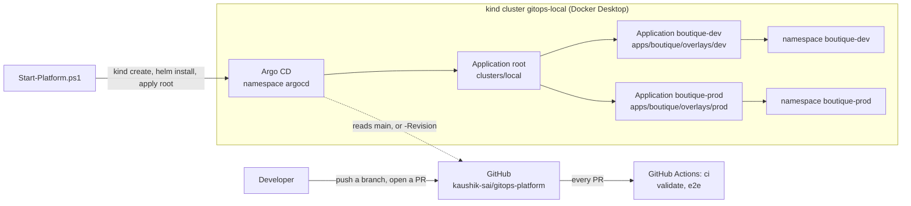

# gitops-platform

[](https://github.com/kaushik-sai/gitops-platform/actions/workflows/ci.yml)

A Kubernetes platform that is changed only through Git. **Phase 1, the foundation:** one PowerShell command creates a local kind cluster, installs Argo CD and points it at this repository. Argo CD then deploys Google's Online Boutique (10 services, a load generator and Redis) into a dev and a prod namespace, and keeps the cluster the same as Git. On every PR, GitHub Actions lints and tests the scripts, validates the manifests, builds the whole platform from scratch from the PR's commit and smoke-tests both environments. **Phase 2, the supply chain:** the frontend is built here from source, pushed to GHCR with an SBOM, signed without a key through GitHub's OIDC token, and deployed by digest: to dev first, then to prod through a promotion PR. Later phases add observability, progressive delivery, policy and a cloud cluster (see [Roadmap](#roadmap)).

## What this shows

| Skill | How | Where |
|---|---|---|
| GitOps with Argo CD | App of apps: one root Application creates one Application per environment. Automated sync with prune and self-heal, so manual changes are reverted | [clusters/local/](clusters/local/) |
| Kustomize base and overlays | The upstream release manifest vendored unchanged; dev and prod differ only in their overlays | [apps/boutique/](apps/boutique/) |
| Reproducible local Kubernetes | kind node image pinned by digest, pinned Argo CD chart, one command up and one command down | [bootstrap/](bootstrap/), [scripts/](scripts/) |
| Helm | Argo CD installed from a pinned OCI chart; the root is a small Helm chart so one value sets the revision for every Application | [bootstrap/argocd-values.yaml](bootstrap/argocd-values.yaml), [clusters/local/](clusters/local/) |
| Testable PowerShell | Every tool call goes through one wrapper (`Invoke-Cli`) that Pester mocks, so tests need no Docker or cluster | [scripts/lib/Cli.ps1](scripts/lib/Cli.ps1), [tests/](tests/) |
| CI that deploys | The `e2e` job builds a kind cluster on the runner, deploys the PR's own commit and smoke-tests dev and prod | [.github/workflows/ci.yml](.github/workflows/ci.yml) |
| Safe defaults | Every kubectl and helm call names the kind context; API server and port-forwards on 127.0.0.1 only; read-only Argo CD UI | [docs/DECISIONS.md](docs/DECISIONS.md) #7, #13 |
| Building from source | The Online Boutique frontend vendored at v0.10.7, with one addition: a `FAIL_RATE` switch for the Phase 4 bad-release drill. CI runs its Go tests and builds the image on every PR | [src/frontend/](src/frontend/) |
| Software supply chain | GHCR image by digest, SPDX SBOM from Syft, cosign keyless signature and SBOM attestation, verified logged out, as anyone can | [.github/workflows/release.yml](.github/workflows/release.yml) |
| Promotion by pull request | dev and prod pin the frontend separately. A release opens the dev PR; `promote` verifies dev's image and opens the prod PR. Both PRs get the full CI | [.github/workflows/promote.yml](.github/workflows/promote.yml), [scripts/Set-FrontendImage.ps1](scripts/Set-FrontendImage.ps1) |
| Written decisions and operations | Numbered decisions, a design with a resource budget, a runbook | [DESIGN.md](DESIGN.md), [RUNBOOK.md](RUNBOOK.md) |

## Architecture



The `e2e` job runs the same `Start-Platform.ps1` in a kind cluster on the GitHub runner, with `-Revision` set to the PR's commit. How a frontend build gets from a merge to dev and then prod is drawn in [DESIGN.md](DESIGN.md#frontend-images-release-and-promotion-phase-2).

## Prerequisites

Windows with PowerShell 7 (the scripts also run on Linux, as in CI) and:

| Tool | Version | Needed for |
|---|---|---|
| Docker Desktop, Linux containers | Docker Engine 29.8.2 used; about 7.6 GiB of memory for Docker | the kind cluster |
| kind | v0.33.0 | the cluster (node image `kindest/node:v1.37.0`, pinned by digest) |
| Helm | v4.3.0 | installing Argo CD (chart `argo-cd` 10.10.3 = Argo CD v3.5.5) |
| kubectl | 1.36 to 1.38 (one minor version either side of Kubernetes 1.37) | everything |
| PowerShell | 7.4+ (built with 7.6.7) | the scripts |
| Pester | 5.x (CI pins 5.9.1) | unit tests |
| PSScriptAnalyzer | 1.x (CI pins 1.25.0) | lint |
| kubeconform | 0.8.0 (as in CI); optional locally | manifest schema checks |
| cosign | v3.x (CI pins 3.1.3); optional locally | verifying the frontend image's signature |
| Go | optional; the Dockerfile brings its own | running the frontend's tests outside Docker |

Internet access is needed: the cluster pulls images, and Argo CD reads this repository from GitHub. `Start-Platform.ps1` stops early, with one message per problem, if docker, kind, helm or kubectl is missing or Docker is not running.

## Bring everything up (one command)

```powershell
pwsh ./scripts/Start-Platform.ps1
```

This command:
1. Creates the kind cluster `gitops-local` from [bootstrap/kind-config.yaml](bootstrap/kind-config.yaml), or reuses it if it exists.
2. Installs or upgrades Argo CD (Helm release `argocd`, namespace `argocd`) with [bootstrap/argocd-values.yaml](bootstrap/argocd-values.yaml).
3. Applies the root Application. It points Argo CD at `clusters/local` in this repository at `-Revision` (default `main`). From then on Argo CD deploys everything else from Git.
4. Waits up to 15 minutes until every Application is Synced and Healthy, printing the status table when it changes.
5. Prints the port-forward commands below.

It is safe to run again. Options:

| Parameter | Default | Use |
|---|---|---|
| `-ClusterName` | `gitops-local` | kind cluster name; the kubectl context is `kind-<name>` |
| `-RepoUrl` | `https://github.com/kaushik-sai/gitops-platform.git` | repository Argo CD deploys from (a fork, or the repo under test in CI) |
| `-Revision` | `main` | branch, tag or commit SHA to deploy |
| `-TimeoutSeconds` | `900` | how long to wait for Synced and Healthy |
| `-NoWait` | off | return right after applying the root Application |

## Tear down (one command)

```powershell
pwsh ./scripts/Stop-Platform.ps1
```

This deletes the kind cluster. Nothing lives outside it: Git holds the configuration, so `Start-Platform.ps1` rebuilds the same platform. It is safe to run when there is no cluster.

## Open Argo CD and Online Boutique

Each command runs until Ctrl+C, so use one terminal per command:

```powershell
kubectl --context kind-gitops-local -n argocd port-forward svc/argocd-server 8080:80        # Argo CD:       http://127.0.0.1:8080
kubectl --context kind-gitops-local -n boutique-dev port-forward svc/frontend 8081:80   # Boutique dev:  http://127.0.0.1:8081
kubectl --context kind-gitops-local -n boutique-prod port-forward svc/frontend 8082:80  # Boutique prod: http://127.0.0.1:8082
```

- The Argo CD UI has no login and is read-only on purpose: changes go through Git. The `admin` account exists for break-glass only (see [RUNBOOK.md](RUNBOOK.md)).
- Port-forwards listen on 127.0.0.1 only.

## Deploy a branch

Argo CD reads from GitHub, not from your disk, so commit and push first:

```powershell
git push origin feature/my-change
pwsh ./scripts/Start-Platform.ps1 -Revision feature/my-change   # or a commit SHA

pwsh ./scripts/Start-Platform.ps1 -Revision main                # back to main
```

On an existing cluster this only updates the root Application. The root passes the revision on to `boutique-dev` and `boutique-prod`. CI does the same with the PR's commit SHA. To deploy from a fork, add `-RepoUrl https://github.com/<you>/gitops-platform.git`.

## Release and promote the frontend

Merging a change under `src/frontend/` starts the `release` workflow. It publishes and signs the image, then opens a PR titled "Deploy frontend sha-... to dev". Merge it, and Argo CD deploys the new image to `boutique-dev`. When dev looks right, take the same image to prod:

```powershell
gh workflow run promote.yml --ref main   # or Actions, promote, Run workflow
```

`promote` verifies the image dev runs and opens a PR titled "Promote frontend ... from dev to prod". Merging it deploys to `boutique-prod`.

See what each environment runs, and verify an image yourself:

```powershell
pwsh ./scripts/Set-FrontendImage.ps1 -Environment dev -Show
pwsh ./scripts/Set-FrontendImage.ps1 -Environment prod -Show

$image = pwsh ./scripts/Set-FrontendImage.ps1 -Environment prod -Show
cosign verify --certificate-identity https://github.com/kaushik-sai/gitops-platform/.github/workflows/release.yml@refs/heads/main `
    --certificate-oidc-issuer https://token.actions.githubusercontent.com $image
cosign verify-attestation --type spdxjson --certificate-identity https://github.com/kaushik-sai/gitops-platform/.github/workflows/release.yml@refs/heads/main `
    --certificate-oidc-issuer https://token.actions.githubusercontent.com $image
```

One-time setup in the repository settings, both needed by the workflows above:
- Settings, Actions, General: allow GitHub Actions to create and approve pull requests. Without it `gh pr create` fails with a permissions error.
- After the first release, the `gitops-platform/frontend` package on the repository page: Package settings, Change visibility, Public. kind pulls without credentials; the release run stops with this instruction until the package is public.

## Lint and tests

```powershell
# Lint: Error and Warning findings fail CI; Information is only shown
Invoke-ScriptAnalyzer -Path . -Recurse -Settings ./PSScriptAnalyzerSettings.psd1

# Unit tests (no Docker or cluster needed: every tool call goes through the mocked Invoke-Cli)
Invoke-Pester -Path ./tests -Output Detailed

# Render what Argo CD renders, and check it against the Kubernetes 1.37 schemas
kubectl kustomize apps/boutique/overlays/dev | kubeconform -strict -summary -kubernetes-version 1.37.0 -
kubectl kustomize apps/boutique/overlays/prod | kubeconform -strict -summary -kubernetes-version 1.37.0 -
helm template root clusters/local --set targetRevision=feature/my-change

# Smoke test a running platform: /_healthz, /, a product page, /cart
pwsh ./scripts/Test-Smoke.ps1 -Environment dev
pwsh ./scripts/Test-Smoke.ps1 -Environment prod
```

The root chart renders Argo CD Applications, so CI checks it with an extra schema location for the Argo CD CRD. The exact command is in [.github/workflows/ci.yml](.github/workflows/ci.yml).

The `ci` workflow runs on every PR to `main`, on every push to `main` (for the badge) and on demand:

| CI job | What it runs |
|---|---|
| `validate` | PSScriptAnalyzer, Pester, the frontend's Go tests and image build, kubeconform on every overlay and on the rendered root chart |
| `e2e` (only after `validate` passes) | A kind cluster on the runner, `Start-Platform.ps1` deploying the commit under test from GitHub, `Test-Smoke.ps1` on dev and prod, diagnostics on failure |

The release and promote PRs are opened by a workflow, which starts no `pull_request` run, so those workflows dispatch `ci` on their branch to get the same two checks.

## Repository layout

| Path | What |
|---|---|
| [bootstrap/kind-config.yaml](bootstrap/kind-config.yaml) | kind cluster: one node, image pinned by digest, API server on 127.0.0.1 |
| [bootstrap/argocd-values.yaml](bootstrap/argocd-values.yaml) | Argo CD Helm values: read-only anonymous UI, no Dex, no notifications |
| [clusters/local/](clusters/local/) | Root Helm chart: one Argo CD Application per environment in `values.yaml` |
| [apps/boutique/base/](apps/boutique/base/) | Online Boutique for every environment; removes the `frontend-external` LoadBalancer Service |
| [apps/boutique/base/upstream/](apps/boutique/base/upstream/) | Upstream release manifest v0.10.7, unchanged, with its LICENSE and source |
| [apps/boutique/overlays/dev/](apps/boutique/overlays/dev/), [prod/](apps/boutique/overlays/prod/) | Namespace, `environment` label and the frontend image; dev also removes the load generator |
| [src/frontend/](src/frontend/) | The frontend's source, v0.10.7, with the `FAIL_RATE` switch; [VENDORED.md](src/frontend/VENDORED.md) lists every change from upstream |
| [scripts/Start-Platform.ps1](scripts/Start-Platform.ps1) | Cluster, Argo CD, root Application, wait for Synced and Healthy |
| [scripts/Stop-Platform.ps1](scripts/Stop-Platform.ps1) | Deletes the cluster |
| [scripts/Test-Smoke.ps1](scripts/Test-Smoke.ps1) | Smoke test of one environment through a port-forward |
| [scripts/Set-FrontendImage.ps1](scripts/Set-FrontendImage.ps1) | Sets, copies or shows the frontend image pinned in an overlay |
| [scripts/lib/Cli.ps1](scripts/lib/Cli.ps1) | `Invoke-Cli` (the only place that runs docker, kind, helm, kubectl), `Get-KubeContext` |
| [tests/](tests/) | Pester tests for the scripts |
| [.github/workflows/ci.yml](.github/workflows/ci.yml) | Workflow `ci`: jobs `validate` and `e2e` |
| [.github/workflows/release.yml](.github/workflows/release.yml), [promote.yml](.github/workflows/promote.yml) | Publish, sign and release the frontend to dev; promote dev's image to prod |
| [PSScriptAnalyzerSettings.psd1](PSScriptAnalyzerSettings.psd1) | Lint rules (the same as sk-devops-svc) |
| [.gitattributes](.gitattributes) | LF line endings for YAML and scripts, also on Windows |
| [DESIGN.md](DESIGN.md), [RUNBOOK.md](RUNBOOK.md), [docs/DECISIONS.md](docs/DECISIONS.md) | Design, troubleshooting, decisions |

## Roadmap

| Phase | Scope | Status |
|---|---|---|
| 1. Foundation | kind, Argo CD app of apps, Online Boutique in dev and prod, scripts, Pester, CI with an end-to-end deploy | Done |
| 2. Build and supply chain | Frontend built from source with a `FAIL_RATE` switch, SBOM (Syft), keyless signing (cosign) with GitHub OIDC, GHCR, promotion PRs from dev to prod | In progress |
| 3. Observability and SLOs | kube-prometheus-stack, Loki, Tempo, OpenTelemetry Collector, SLOs with burn-rate alerts, Gateway API ingress (Envoy Gateway) | Planned |
| 4. Progressive delivery | Argo Rollouts canary for the frontend, Prometheus analysis, automatic rollback, a bad-release drill | Planned |
| 5. Policy and secrets | Kyverno, AppProjects, NetworkPolicies, External Secrets, Argo CD managing itself | Planned |
| 6. Cloud | Terraform for AKS and ACR with GitHub OIDC: apply, record evidence, destroy | Planned |
| After | Separate projects on this cluster: autoscaled CI runners (KEDA, ARC), an MCP incident copilot | Planned |

Details per phase are in [DESIGN.md](DESIGN.md#roadmap).

## Docs

| Document | What |
|---|---|
| [DESIGN.md](DESIGN.md) | Goals, how GitOps works here, environments, resource budget, what changes in a real setup, the phases |
| [RUNBOOK.md](RUNBOOK.md) | Troubleshooting the local platform, with exact commands |
| [docs/DECISIONS.md](docs/DECISIONS.md) | Numbered decisions: question, decision, why |
| [docs/EVIDENCE.md](docs/EVIDENCE.md) | Real runs: CI on GitHub and the laptop, with timings and results |

## Verification status

Measured on 2026-10-15 on a Windows 11 laptop with 16 GB of RAM and Docker Desktop at 7.6 GiB and 12 CPUs.

| What | Result |
|---|---|
| `Start-Platform.ps1 -NoWait` from nothing | kind cluster and Argo CD in 128 s; the root Application was created |
| Boutique, both overlays | Applied directly with `kubectl apply -k`, because the GitHub repository did not exist yet and Argo CD could not sync. All 23 pods Running in 191 s, including image pulls |
| `Test-Smoke.ps1` | 4/4 PASS in boutique-dev and 4/4 in boutique-prod; no port-forward process left behind |
| kind node memory | 2.27 GiB used of 7.6 GiB |
| CPU requests on the node | 3790m in total (boutique-dev 1270m, boutique-prod 1570m, kube-system 950m; Argo CD sets none). That fits the 4 vCPUs of a GitHub-hosted runner with 210m to spare |
| Lint and tests | PSScriptAnalyzer: 0 findings. Pester: 79/79 |
| From GitHub | Argo CD on the laptop synced all three Applications from GitHub at `dc0b135`. The first CI run passed: `validate` in 35 s, then `e2e` built the whole platform on a fresh runner in 195 s. Details are in [docs/EVIDENCE.md](docs/EVIDENCE.md) |
| Phase 2 | Not yet verified end to end: the first release runs when the Phase 2 PR is merged. Local checks only so far: the frontend's Go tests pass and Pester covers `Set-FrontendImage.ps1` |

## Credits

[Online Boutique](https://github.com/GoogleCloudPlatform/microservices-demo) is © Google LLC, licensed under the Apache License 2.0. The v0.10.7 release manifest is vendored unchanged in [apps/boutique/base/upstream/](apps/boutique/base/upstream/) with its [LICENSE](apps/boutique/base/upstream/LICENSE).
